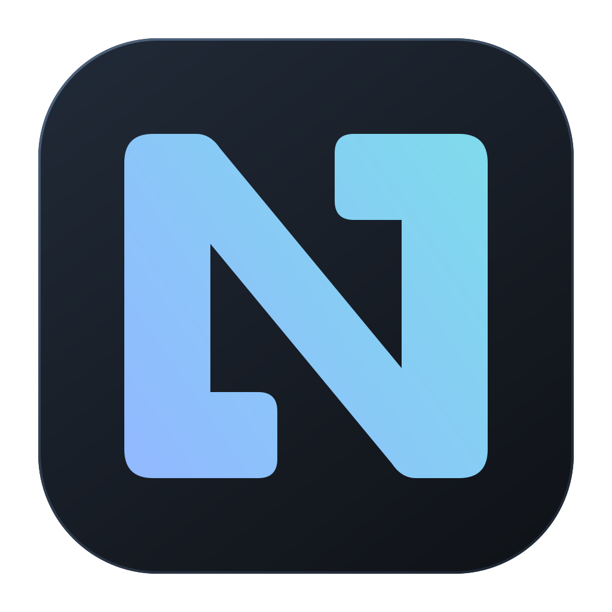
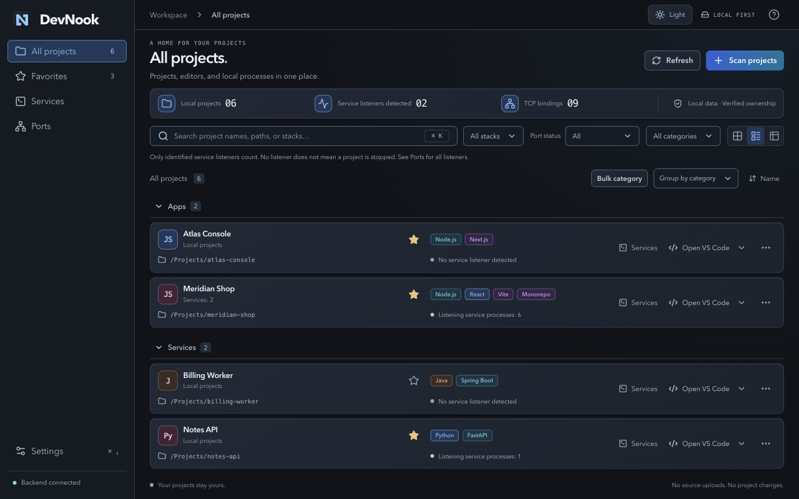
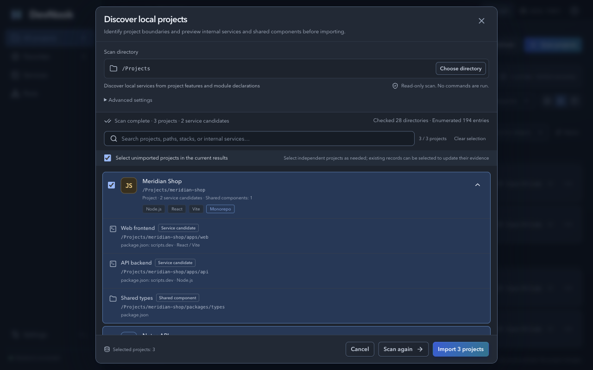
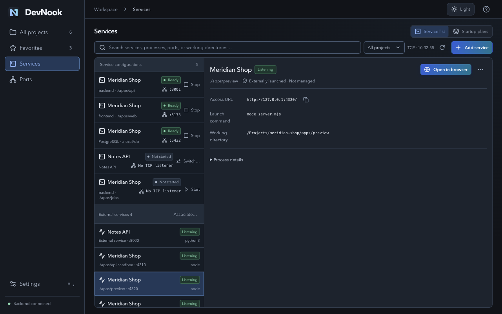
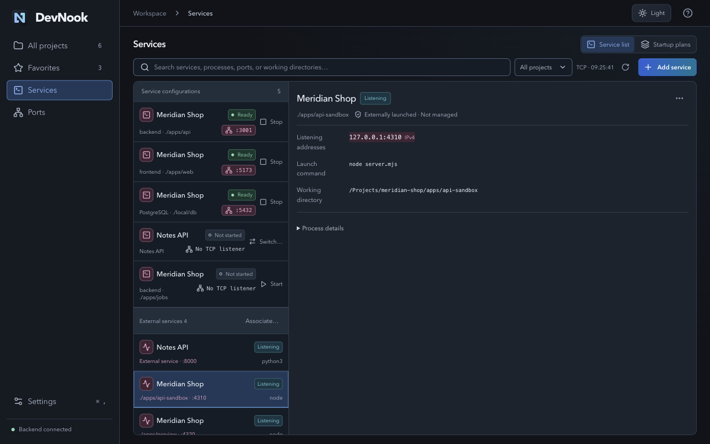
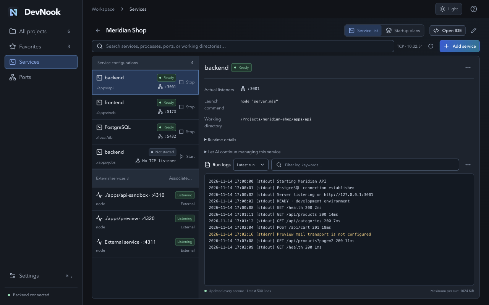
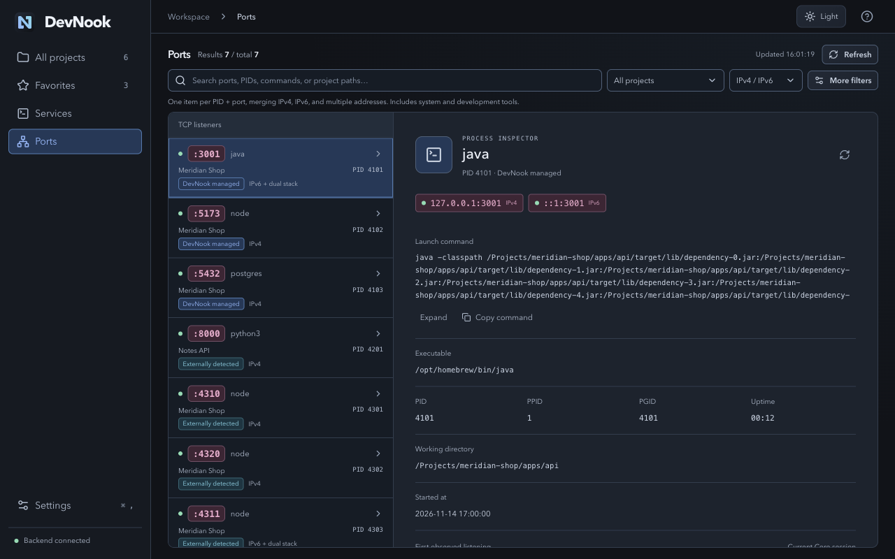
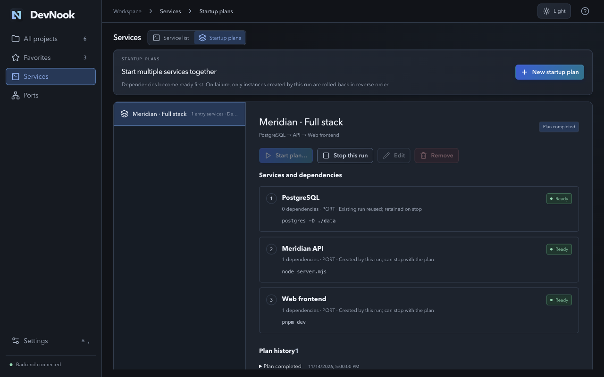
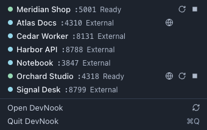

<p align="center">
  
</p>

<h1 align="center">DevNook</h1>

<p align="center">Local projects and development services, managed on your Mac.</p>

<p align="center">
  <a href="README.md">简体中文</a> · <strong>English</strong>
</p>

<p align="center">
  <a href="https://acorn2.github.io/devnook/en/">Website</a> ·
  <a href="#features">What it does</a> ·
  <a href="#quick-start">Quick start</a> ·
  <a href="#cli-and-ai-assistants">CLI / MCP</a> ·
  <a href="#documentation">Documentation</a> ·
  <a href="#future-directions">Future directions</a> ·
  <a href="LICENSE">MIT License</a>
</p>

**Find projects. Run services. Trace ports.** DevNook brings code folders, preferred editors, launch configurations, and runtime state into one macOS desktop app. Import existing projects, confirm frontend and backend starts, read logs, and trace an occupied port to its process and directory.

[Apple Silicon DMG](https://github.com/Acorn2/devnook/releases/download/v0.1.3/DevNook_0.1.3_aarch64.dmg) · [Intel Mac DMG](https://github.com/Acorn2/devnook/releases/download/v0.1.3/DevNook_0.1.3_x64.dmg) · [v0.1.3 release notes and checksums](https://github.com/Acorn2/devnook/releases/tag/v0.1.3) · [Build from source](#quick-start)

If you work across several local projects, start with these tasks:

| What you want to do                       | How DevNook helps                                                                             |
| ----------------------------------------- | --------------------------------------------------------------------------------------------- |
| Find a project and continue working       | Import it, find it with search, categories, or favorites, then open your preferred editor.    |
| Start a frontend and API, then check them | Save launch configurations, confirm execution, and inspect readiness, actual ports, and logs. |
| Investigate an occupied port              | Inspect its listener, process command, working directory, and project association.            |
| Prepare a group of services in order      | Combine registered services into a startup plan and wait for dependencies to become ready.    |



<p align="center"><sub>Project library. Screenshots show the current source interface using demo projects and runtime data, with no personal projects or processes. Installer features follow the release notes for that version.</sub></p>

## Features

### Import projects from disk and organize them your way

Choose a code directory, review candidates, internal services, and shared components, then select what to import. Frontends and backends in one repository can stay together; independent repositories can remain separate.

- Find projects by name, path, stack, category, and service listening status. Use favorites and bulk categorization.
- Switch between a compact list, cards, and a table. Collapse category groups and keep display preferences locally.
- Open projects in installed editors and IDEs such as VS Code, Cursor, and JetBrains. Set global or per-project defaults, or open Finder / Terminal.
- Removing a project record does not delete source code. Scanning, importing, and saving configuration execute no project commands.

<details>
<summary>See the candidate preview before import</summary>



Review project boundaries and components before importing. Select a specific path or use a deeper scan for nonstandard layouts.

</details>

### Save launch commands and keep runs with their logs

Open a project’s services, review suggestions derived from its manifests, or enter a command. Save the configuration, confirm execution, and reuse it next time.

- Start, stop, and restart registered services. Check port conflicts and dependency state before startup.
- The global service list leads with project names; a project's own list leads with service names. Names, relative directories, and actual ports distinguish services in the same project, with matching details on the right.
- Inspect runtime state, actual listeners, launch commands, and working directories. Expand process details when needed.
- Read stdout / stderr by run, search log lines, and retain historical runs separately from configuration.
- Project icons, service markers, and actual ports share consistent project colors. Stack labels have their own colors; state keeps separate colors and text in both themes.
- Started services and logs continue in the local backend after you close the app window.



Web services offer an **Open in browser** button and a copyable access URL. HTTP is the default; HTTPS is in the more menu. APIs with a confirmed non-page root show listening addresses. Unconfirmed entries still allow a browser attempt, so Node runtimes and custom launch commands do not hide access by themselves.

<details>
<summary>See API details and run logs</summary>





</details>

Services started in a terminal or IDE remain external. After identity checks, you can stop one normally, or reuse a saved configuration and separately confirm a switch to DevNook management. Create another configuration only when needed. Configurations without a run show “Not started”; starting normally never stops the external instance. The old environment, historical logs, and IDE debugging session are not migrated.

Service details include “Let AI continue managing this service” to copy its CLI commands and Codex / IDE handoff instructions, or open existing MCP access settings. You and your AI assistant can keep using the same saved configuration. Copying instructions does not execute commands, create grants, or modify client settings.

### Trace a listening port to its process and project

Search ports, PIDs, commands, or paths. Inspect the process command, executable, working directory, start time, and project association. Combine filters for project, address family, runtime, launch source, and more.

Long commands show four lines by default, with expand, collapse, and full-command copy. Hovering a port no longer opens the entire launch command.



TCP IPv4 / IPv6 and multiple addresses are grouped. Managed services and external listeners remain distinct. **No detected listener does not mean a project has stopped.** Processes with unknown identity or unverifiable ownership remain read-only. External stops require identity checks and PID confirmation.

### Prepare several services in dependency order

Under **Services → Startup plans**, combine registered services across projects. Dependencies expand automatically, and downstream services wait for upstream readiness, such as database → API → frontend.



Review the full plan before starting. Existing services are reused. Failure, cancellation, or stopping a plan acts only on runs created by that attempt, retaining pre-existing runs and instances restarted manually afterward. Saving a plan stores configuration without executing it.

### Quick service access from the menu bar

Click the N icon in the macOS menu bar for compact, single-line services grouped by project: running services, services needing attention, and services in favorite projects. Check actual ports, open a browser entry, normally stop a managed service, or jump to details. Single-service projects use one row; only projects with multiple services receive headings. Each opening sizes to the content and keeps its height and order during refresh. Longer lists scroll above a fixed footer, with arrows indicating more content. Search appears above 12 services, or with ⌘F, and matches projects, services and actual ports. Use arrow keys to select, Enter for details and Escape to close. Browser icons require a recently confirmed single web entry with a current process identity; APIs and unknown ports do not get an icon. Start and restart open the existing confirmation flow in the main window. External services remain distinct; stopping them still requires the checks in their detail view.



Closing the main window keeps menu bar access available. Reopen it from the Dock or panel. Quitting DevNook ends the desktop interface while running services continue. The panel shares language and appearance preferences with the main window, and hidden windows pause list refreshes. See the release notes for installer changes.

### Terminal access, AI assistants, and display preferences

The CLI and optional MCP integration share the desktop’s local backend, project library, service configuration, and run history. Query from a terminal or let a coding assistant read state and logs. MCP is read-only by default; control requires a separate scoped grant and the relevant confirmation flow. See [CLI and AI assistants](#cli-and-ai-assistants) below.

The desktop supports **light / dark themes** and **Simplified Chinese / English**. A Chinese primary system language selects Chinese on first launch; all other languages select English. Change it under **Settings → Language** and DevNook remembers your manual choice. Everyday desktop use requires no MCP setup.

<details>
<summary>Project recognition and scan limits</summary>

DevNook recognizes manifests and component metadata for JavaScript / TypeScript, Java / Kotlin, Python, Rust, Go, .NET, PHP, Ruby, Dart / Flutter, Swift / Xcode, and C / C++. Service discovery focuses on backends, web applications, and local development servers. It excludes projects identified as standalone mobile, desktop GUI, or game clients from new candidates.

Default scans follow project features and module declarations. For nonstandard layouts, select a specific directory or enable a deeper scan. Dynamic configurations and custom launchers that static rules cannot resolve need manual input. See [scanner coverage](docs/scanner-features-plan.md) and [service eligibility](docs/service-eligibility-plan.md) for details; these guides are in Chinese.

</details>

## Quick start

To use the desktop app, choose the Apple Silicon or Intel Mac DMG from [GitHub Releases](https://github.com/Acorn2/devnook/releases/latest), open it, and drag DevNook into Applications. The current installers are ad-hoc signed and have not completed Developer ID signing or Apple notarization. macOS may block the first launch; see the [v0.1.3 release notes](docs/releases/v0.1.3.md) for signing details and checksum verification.

The steps below build from source. The target platform is **macOS 12+**, with separate Apple Silicon and Intel builds. The Intel build has passed Rosetta tests and native window startup checks on an Apple Silicon host; Intel hardware and physical macOS 12 devices still need verification. Windows / Linux installers are not available; see the future directions below.

### 1. Prerequisites

| Dependency               | Requirement                               |
| ------------------------ | ----------------------------------------- |
| macOS                    | 12 or later                               |
| Xcode Command Line Tools | macOS SDK and native build tools          |
| Node.js                  | 20.x (20.19+) or 22.12+                   |
| pnpm                     | 10; `package.json` pins the exact version |
| Rust                     | Stable toolchain, including Cargo         |

### 2. Run from source

```sh
git clone https://github.com/Acorn2/devnook.git
cd devnook
pnpm install --frozen-lockfile
pnpm tauri dev
```

`pnpm tauri dev` starts the frontend and native desktop app. Running `pnpm dev` alone provides a browser UI preview, with no access to local project scanning, service management, or system processes.

### 3. Import your first project

1. Click **Scan projects** and choose a directory containing your projects.
2. Review the candidates, select the projects you want, and import them.
3. Open a project in its default editor or visit its services page.
4. Review the launch suggestion. Enter a command if DevNook cannot identify one, then confirm the configuration before starting it.
5. Inspect logs and actual listeners in service details. Open **Ports** to investigate an occupied port.

Scanning, importing, and saving configuration do not execute project commands. The [detailed user guide](docs/USAGE.md) is available in Chinese.

## CLI and AI assistants

### CLI

Use the CLI for terminal queries and scripts. It shares the local backend, configuration, and run history with the desktop app.

```sh
pnpm build:cli
./target/debug/devnook --help
./target/debug/devnook project list
./target/debug/devnook service list
./target/debug/devnook ports
./target/debug/devnook workspace list
```

The CLI also supports service logs, starts, stops, restarts, and startup plans, with a global `--json` output option. Operations that change runtime state follow the relevant preview and confirmation flow. See the [CLI reference](docs/PHASE-3.md#cli) in Chinese for commands.

### MCP (optional)

The stdio MCP adapter lets an AI coding assistant query projects, services, ports, and logs. Find the desktop setup under **Settings → Advanced → AI assistant integration**.

Replace the executable path below with the absolute path to your local CLI. Adapt the configuration to your MCP client's format:

```json
{
  "mcpServers": {
    "devnook": {
      "command": "/absolute/path/to/devnook",
      "args": ["mcp", "serve"]
    }
  }
}
```

The default connection exposes queries only. Service control requires a separate scoped grant and the relevant confirmation flow. MCP does not expose arbitrary shell execution, service configuration writes, external process termination, or force-stop operations. See the [MCP setup guide](docs/PHASE-3.md#mcp-接入) in Chinese for configuration and permission details.

## Data and process control

- **Read-only scanning.** Scans do not execute project scripts, install project dependencies, read `.env`, or follow symbolic links. Review candidates before importing.
- **Local data.** SQLite stores projects and ordinary configuration. macOS Keychain stores sensitive environment values; the database keeps references. Run logs redact registered secret values and use bounded storage.
- **Confirmed execution.** Saving configuration does not launch a command. Starts and restarts require short-lived confirmation tied to the configuration revision. Port conflicts block startup.
- **Independent external processes.** Associating a process with a project does not transfer ownership. Stopping an external service requires identity checks and PID confirmation, and sends SIGTERM only. Force-stop applies only to managed instances with separate confirmation.
- **Services outlive the window.** A separate Core and runner keep confirmed services and logs running after the GUI closes. DevNook installs no LaunchAgent. The backend can exit once no services are active and clients remain idle.

The default data directory is `~/Library/Application Support/com.devnook.desktop/`. Listening status comes from actual TCP snapshots: no detected listener does not establish that a project has stopped, and a failed read appears as unavailable. Local IPC trusts the current macOS user; it does not provide multi-user isolation or remote administration. See [data and runtime boundaries](docs/USAGE.md#数据与边界) in Chinese for details.

## Development and validation

```sh
pnpm check
pnpm format:check
pnpm test:ui
pnpm build
pnpm check:rust
pnpm test
```

The full Rust integration suite also requires **Python 3 and a JDK** and uses isolated data directories and test processes. The repository includes a macOS GitHub Actions workflow for type checks, formatting, UI data tests, Rust tests, CLI builds, and native desktop builds.

<details>
<summary>Build a Release DMG (Apple Silicon)</summary>

```sh
pnpm tauri build --no-bundle
APPLE_SIGNING_IDENTITY=- CI=true pnpm tauri bundle --bundles app,dmg
node scripts/record-release.mjs
```

The app is written to `target/release/bundle/macos/DevNook.app`; the DMG and checksum are under `target/release/bundle/dmg/`. The Release profile enables link-time optimization and symbol stripping. These commands use a local ad-hoc signature and do not establish Developer ID signing or Apple notarization. See the [Release guide](docs/RELEASING.md) for validation and distribution steps.

</details>

<details>
<summary>Build a local Debug app</summary>

```sh
pnpm tauri build --debug --bundles app
codesign --force --deep --sign - target/debug/bundle/macos/DevNook.app
codesign --verify --strict --deep target/debug/bundle/macos/DevNook.app
```

The output is `target/debug/bundle/macos/DevNook.app`. These commands apply a local ad-hoc signature for development validation; they do not provide Developer ID signing or Apple notarization. Debug bundle size does not represent the final Release installer size.

</details>

### Repository structure

```text
apps/
  desktop/
    src/              React + TypeScript interface
    src-tauri/        Tauri native adapter
  cli/                CLI and stdio MCP
crates/
  devnook-core/       Scanning, storage, processes, services, and orchestration
site/                 Static Chinese and English product website
scripts/              Local builds, website generation, and checks
docs/                 Usage guides, design notes, and development records
```

DevNook uses **Tauri 2, React 19, TypeScript, Rust, and SQLite**. Business logic lives in Core; the desktop and CLI provide presentation and adapters. See [ARCHITECTURE.md](ARCHITECTURE.md) for implementation details.

## Documentation

Build the website with `pnpm site:build`, validate it with `pnpm site:check`, and preview it locally with `pnpm site:preview`. See [GitHub Pages](docs/GITHUB-PAGES.md) for deployment steps.

The following detailed guides are currently in Chinese. Both README versions cover the same setup, features, and operating boundaries.

| Document                                                                                      | Contents                                                                          |
| --------------------------------------------------------------------------------------------- | --------------------------------------------------------------------------------- |
| [User guide](docs/USAGE.md)                                                                   | Project discovery, editor selection, services, appearance, language, and upgrades |
| [Service supervision](docs/PHASE-2.md)                                                        | Lifecycle, readiness checks, logs, and process identity                           |
| [Startup plans, CLI, and MCP](docs/PHASE-3.md)                                                | Dependency orchestration, terminal commands, AI integration, and grants           |
| [Scanner design](docs/scanner-features-plan.md)                                               | Project manifests, module declarations, and scan limits                           |
| [Service eligibility](docs/service-eligibility-plan.md)                                       | Distinguishing services, development servers, and clients                         |
| [Architecture](ARCHITECTURE.md) · [Tech stack](TECH-STACK.md) · [Interface design](DESIGN.md) | Engineering structure and design conventions                                      |
| [Development record](docs/DEVELOPMENT-PLAN.md)                                                | Implemented features, recorded validation, and known limitations                  |

## Future directions

DevNook currently focuses on improving local project and service management on macOS. Investment in additional platforms and larger features will depend on sustained adoption, community feedback and contributions, and maintainer capacity. These are candidate directions with no fixed schedule.

| Candidate direction                  | What needs evaluation                                                                                                             |
| ------------------------------------ | --------------------------------------------------------------------------------------------------------------------------------- |
| Windows support                      | Native process identity, port inspection, development apps, and background service management, followed by end-to-end validation. |
| Linux support                        | The supported distributions, desktop environments, and process management behavior, based on actual user demand.                  |
| Deeper IDE integration               | Project and service workflows in editors such as IntelliJ IDEA, guided by concrete problems from existing users.                  |
| macOS distribution and compatibility | Feedback from Intel and older macOS hardware, Developer ID signing, Apple notarization, and upgrade experience.                   |

Share your workflow, platform, and problems in [Issues](https://github.com/Acorn2/devnook/issues). Real usage feedback, reproducible examples, and code contributions help set priorities; stars are another way to express interest in the project.

## Contributing

Contributions can include reproducible bugs, project recognition examples, translation fixes, and feature proposals.

- **Report a bug:** Include your macOS version, chip architecture, DevNook version, reproduction steps, and expected behavior. Remove sensitive information from logs and screenshots.
- **Improve recognition:** Provide a minimal manifest, directory layout, and expected result. Omit real credentials, `.env` files, and private source code.
- **Submit code:** Keep changes focused on one issue, include relevant validation, and discuss new behavior in an [issue](https://github.com/Acorn2/devnook/issues) first. Keep both README versions in sync.

Process control and scanning rules define key project boundaries. Preserve read-only scanning, explicit execution confirmation, process identity verification, and isolated tests. Fix problems without adding automatic force-kills or broadening permissions.

## License and acknowledgments

DevNook uses the [MIT License](LICENSE). Third-party dependencies retain their own licenses; see [THIRD_PARTY_NOTICES.md](THIRD_PARTY_NOTICES.md).

Product research included CodeDeck, Runbox, and localhost. See the [reference research](docs/REFERENCE-RESEARCH.md) for recorded sources and reuse boundaries. The current implementation incorporates none of their source code or visual assets.
