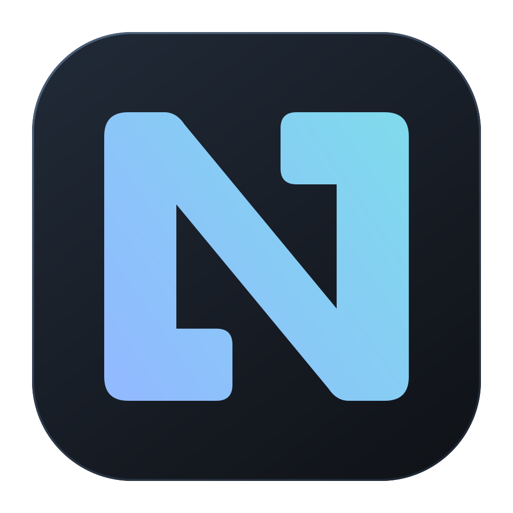
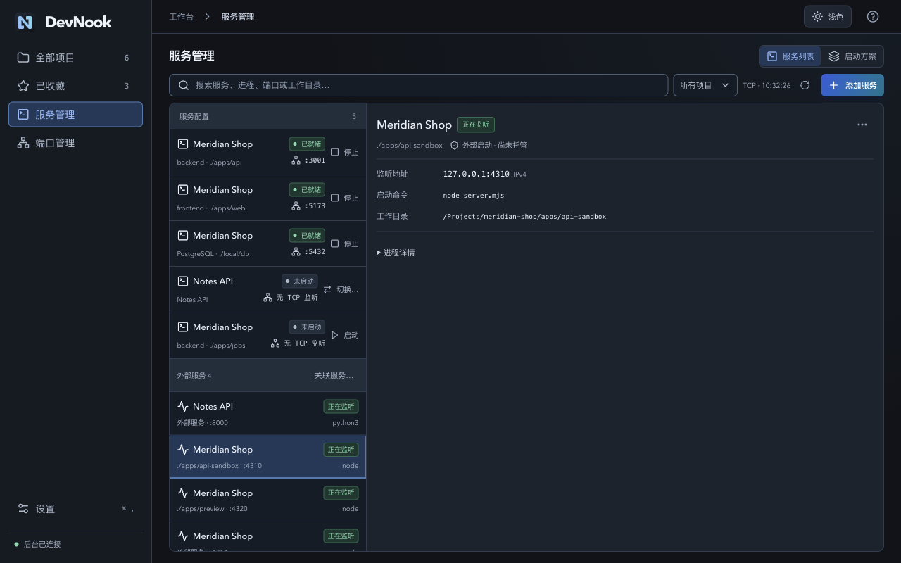
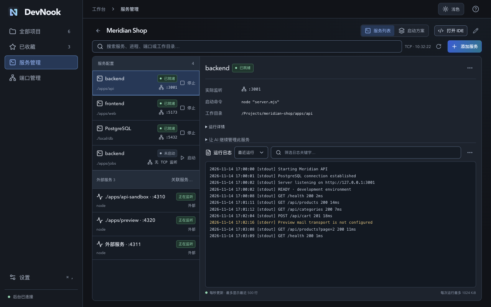
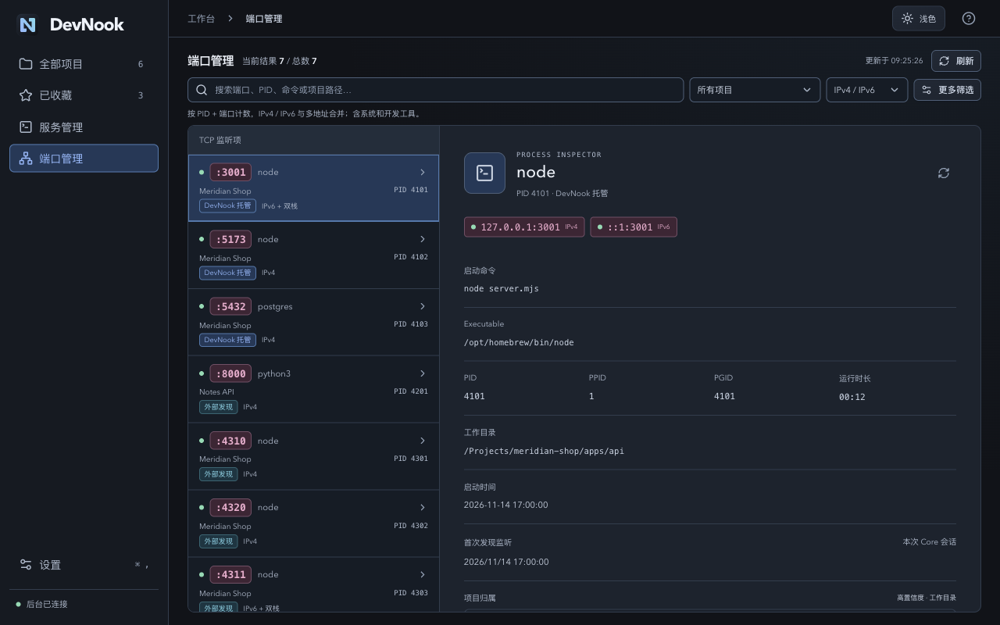
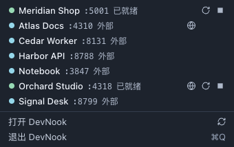
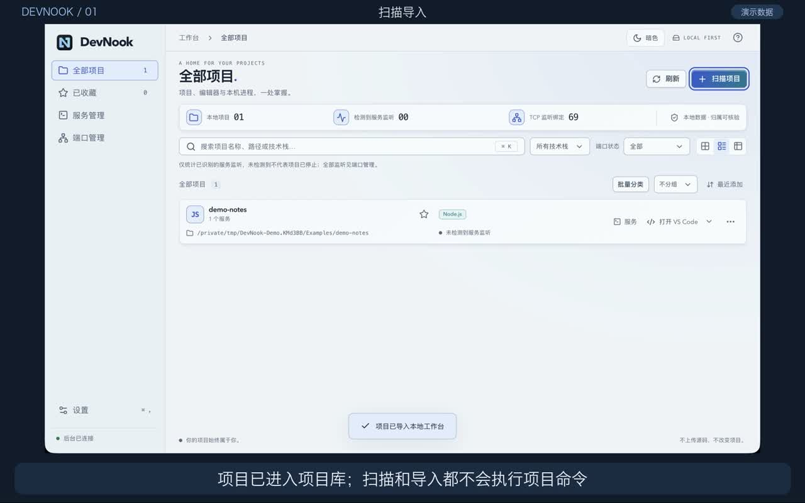

<p align="center">
  
</p>

<h1 align="center">DevNook</h1>

<p align="center">macOS 上的本地项目与开发服务管理器。</p>

<p align="center">
  <strong>简体中文</strong> · <a href="README.en.md">English</a>
</p>

<p align="center">
  <a href="https://github.com/Acorn2/devnook/releases/latest"></a>
  
  
  
  <a href="LICENSE"></a>
</p>

<p align="center">
  <a href="https://acorn2.github.io/devnook/">官网</a> ·
  <a href="#核心功能">能做什么</a> ·
  <a href="#实操演示">实操演示</a> ·
  <a href="#快速开始">快速开始</a> ·
  <a href="#cli-与-ai-助手">CLI / MCP</a> ·
  <a href="#文档">文档</a> ·
  <a href="#后续方向">后续方向</a> ·
  <a href="LICENSE">MIT License</a>
</p>

**找项目、开服务、查端口。** DevNook 把磁盘上的代码工程、常用编辑器、启动配置和运行状态放进一个桌面工作台。你可以导入已有项目，确认启动前后端服务，集中查看日志，或从占用端口找到对应进程和目录。

[Apple Silicon DMG](https://github.com/Acorn2/devnook/releases/download/v0.1.10/DevNook_0.1.10_aarch64.dmg) · [Intel Mac DMG](https://github.com/Acorn2/devnook/releases/download/v0.1.10/DevNook_0.1.10_x64.dmg) · [v0.1.10 发布说明与校验文件](https://github.com/Acorn2/devnook/releases/tag/v0.1.10) · [从源码运行](#快速开始)

如果你同时维护几个本地工程，可以从这些任务开始：

| 常见开发场景与痛点             | 在 DevNook 中怎么做                                                     |
| ------------------------------ | ----------------------------------------------------------------------- |
| 找回散落工程并继续开发         | 扫描导入后，用搜索、技术栈、分类或收藏定位，一键唤起常用编辑器与终端。  |
| 启动多端服务并监视健康与资源   | 保存配置并安全启动，在详情页实时查看内存 (RSS)、CPU 耗时、实际端口与日志。 |
| 排查“端口已被占用”或排查杂音   | 端口管理自带分类过滤，一键过滤系统无用端口，穿透查看占用进程与项目归属。 |
| 编排有先后依赖的一组微服务     | 组成启动方案，按拓扑等待上游服务就绪后自动启动下游，支持安全回滚。       |


<p align="center"><sub>项目库。本文截图来自当前源码界面，使用演示项目与运行数据，不包含个人工程或进程信息。安装包功能以对应版本的发布说明为准。</sub></p>

## 核心功能

### 项目从目录导入，按习惯整理

选择代码目录，核对扫描候选、内部服务与共享组件，再勾选导入。同一仓库中的前后端可以保留在一个项目里，独立仓库也能单独选择。

- 按名称、路径、技术栈、分类与服务监听状态查找项目，支持收藏与批量分类。
- 紧凑列表、卡片和表格随时切换，分类分组可折叠，展示偏好在本机记住。
- 用已安装的 VS Code、Cursor、JetBrains 等编辑器 / IDE 打开工程；可设置全局或项目默认应用，也可打开 Finder / Terminal。
- 移除项目档案不会删除源码。扫描、导入和保存配置都不会运行项目命令。

<details>
<summary>查看导入前的候选预览</summary>


预览项目边界与组件后再导入。非标准目录可选择具体路径或启用深度补扫。

</details>

### 启动命令保存下来，运行与日志放在一起

进入项目的服务页，核对从工程清单和明确的本机启动入口识别出的建议，或填写自己的启动命令。保存配置后确认执行，下次开发时复用这份配置。

- 分目录的前后端可分别配置：FastAPI 支持识别约定入口里的显式 Uvicorn 启动，能确认固定端口时预填端口和 TCP 就绪检查。数据库和服务依赖仍由用户设置。
- 启动、停止、重启已登记的服务；启动前检查端口冲突与依赖状态。
- **高频操作直达与清晰状态**：服务卡片提供语义明确的启停微型操作按钮；服务详情页头部常驻「打开网页」、「重启」、「停止」与「编辑配置」快捷入口。
- **实时性能指标监视**：基于 macOS 内核系统调用实时获取进程的物理内存常驻集（RSS）与 CPU 累计运行时间，在详情头部与参数中直观掌握资源开销。
- 全局服务列表优先展示项目名，项目内优先展示服务名；同一项目的多个服务通过服务名、相对目录与实际端口区分，右侧详情保持一致。
- 点击服务配置、启动建议或已关联外部服务旁的星标，即可收藏所属项目；同项目的星标与项目库同步。
- 同时查看运行状态、实际监听端口、启动命令与工作目录，进程信息可按需展开。
- 项目图标、服务标记和实际端口保持一致配色，技术栈使用彩色标签；状态保留独立颜色与文字，浅暗主题均支持。
- **可读日志与防打扰滚底**：stdout / stderr 输出采用本地化时间戳（如 `[15:23:40]`）；排查报错上滑查阅时智能保持视口位置，滚回底部自动恢复实时吸附跟随。
- 关闭应用窗口后，本机后台继续维护已经启动的服务与日志。


网页服务提供“打开浏览器”和可复制的访问地址，默认使用 HTTP，HTTPS 放在更多菜单中。API 等明确不提供根页面的服务展示监听地址；入口尚未确认时仍可尝试打开，不会只因使用 Node 或自定义启动命令就隐藏入口。

<details>
<summary>查看 API 详情与运行日志</summary>





</details>

由终端或 IDE 启动的服务会独立标为外部。你可以核验身份后正常停止，或复用已保存的配置，单独确认切换为 DevNook 托管；需要新配置时再显式创建。未运行过的配置显示“未启动”，普通启动不会关闭外部实例。旧环境、历史日志与 IDE 调试会话不会迁移。

服务详情提供“让 AI 继续管理此服务”，可复制当前服务的 CLI 命令和 Codex / IDE 交接说明，或进入既有 MCP 接入设置。托管后你和 AI 仍可共用配置；复制指引不会执行命令、创建授权或修改客户端配置。

### 从端口定位进程与项目

在端口管理中搜索端口、PID、命令或路径，查看进程命令、可执行文件、工作目录、启动时间与项目归属。项目、地址族、运行时和启动来源等筛选可以组合使用。

- **顶部分类分段降噪**：顶部提供 `全部` / `DevNook 托管` / `项目关联` / `系统与未关联` 快捷过滤胶囊与实时计数，一键隐藏 macOS 60+ 系统后台进程干扰，专注排查业务端口。
- **进程详情精准穿透**：大标题直观显示所属项目名称（如 `source-desk · node`），并同步展示该进程的物理内存 (RSS)、累计 CPU 时间与完整启动参数。
- 长命令默认显示四行，可展开、收起并复制完整内容；悬停端口不会弹出整段启动命令。



TCP IPv4 / IPv6 与多地址会合并展示，托管服务和外部监听保持区分。**未检测到监听不代表项目已停止。** 未知身份或无法核验归属的进程保持只读，外部停止需要核验并输入 PID 确认。

### 多个服务，按依赖顺序准备

在“服务管理 → 启动方案”中组合已登记的服务，入口可以来自不同项目。依赖会自动展开，等待上游就绪后再启动下游，例如数据库 → API → 前端。


启动前可预览完整计划。原本已运行的服务会被复用；失败、取消或停止方案时，只处理本次创建的实例，保留原有运行和后来手动重启的实例。保存方案只保存配置，不会自动执行。

方案启动失败后，可在当前方案或编排记录中看到失败服务和当时的检查条件。点击“查看这次运行的日志”可打开对应实例的输出，重试成功后仍可回看。

### 从菜单栏快速查看服务

点击 macOS 菜单栏中的 N 图标，以紧凑单行按项目查看运行中、需关注及收藏项目的服务，核对实际端口，打开浏览器、正常停止托管服务或进入详情。单服务项目直接一行，多服务项目才分组；每次展开按内容设置高度，刷新时保持高度和顺序。较长列表只滚动服务区，底部入口固定，上下箭头提示剩余内容。超过 12 条自动显示搜索，也可用 ⌘F 按项目、服务或端口查找；方向键选择，Enter 进入详情，Escape 收起。浏览器按钮只显示近期在详情确认且身份仍有效的单一网页入口，API / 未知端口不会出现地球图标。启动与重启会进入主窗口的原有确认流程；外部服务单独标识，其停止仍在详情中核验操作。



关闭主窗口后菜单栏入口保留，可从 Dock 或面板恢复主窗口。退出 DevNook 只退出桌面界面，已运行服务继续运行。菜单栏与主窗口共用中英、浅暗偏好，隐藏窗口暂停列表刷新。安装包更新内容见对应版本的发布说明。

### 终端、AI 助手与展示偏好

CLI 与可选的 MCP 接入共用桌面的本机后台、项目库、服务配置与运行记录。可在终端查询，或让编程助手读取状态和日志；MCP 默认只读，服务控制另需范围授权与对应确认。接入方式见下方 [CLI 与 AI 助手](#cli-与-ai-助手)。

桌面支持**浅色 / 暗色**和**简体中文 / English**。首次启动按系统首选语言选择：中文使用中文，其余语言使用英文；在“设置 → 界面语言”中可随时切换并记住手动选择。日常桌面使用无需配置 MCP。

<details>
<summary>项目识别范围与扫描限制</summary>

支持 JavaScript / TypeScript、Java / Kotlin、Python、Rust、Go、.NET、PHP、Ruby、Dart / Flutter、Swift / Xcode、C / C++ 的工程清单与组件线索。服务发现聚焦后端、Web 和本机开发服务器；明确的纯移动、桌面 GUI 和游戏客户端不会单独列为新候选。

默认扫描依据工程特征与模块声明发现项目。非标准目录可选择具体路径或启用深度补扫；静态识别无法解析的动态配置与自定义启动入口需要手动补充。详细范围见[扫描设计与类型覆盖](docs/scanner-features-plan.md)和[服务与客户端扫描边界](docs/service-eligibility-plan.md)。

</details>

## 实操演示

从扫描导入、启动服务和看日志，到按端口找进程、按依赖启动多项服务。四段都是演示项目的原生录屏，每段不到 20 秒，无声也能跟着操作。

<a href="https://acorn2.github.io/devnook/#demos"></a>

## 快速开始

直接使用可从 [GitHub Releases](https://github.com/Acorn2/devnook/releases/latest) 按芯片选择 Apple Silicon 或 Intel Mac DMG，打开后将 DevNook 拖入 Applications。当前安装包采用 ad-hoc 签名，尚未完成 Developer ID 签名或 Apple 公证；首次打开可能被 macOS 阻止，来源与校验说明见 [v0.1.10 发布说明](docs/releases/v0.1.10.md)。

以下步骤用于从源码运行，目标平台为 **macOS 12+**，提供 Apple Silicon 与 Intel 两种构建。Intel 构建已通过 Apple Silicon 主机上的 Rosetta 测试；本版未重新验收原生窗口交互，Intel 和 macOS 12 真机仍需补充验证。Windows / Linux 暂不提供安装包，后续方向见下方说明。

### 1. 准备开发环境

| 依赖                     | 要求                               |
| ------------------------ | ---------------------------------- |
| macOS                    | 12 或更高版本                      |
| Xcode Command Line Tools | 提供 macOS SDK 与本机构建工具      |
| Node.js                  | 20.19+（20.x）或 22.12+            |
| pnpm                     | 10，具体版本由 `package.json` 固定 |
| Rust                     | stable 工具链，包含 Cargo          |

### 2. 从源码运行

```sh
git clone https://github.com/Acorn2/devnook.git
cd devnook
pnpm install --frozen-lockfile
pnpm tauri dev
```

`pnpm tauri dev` 会同时启动前端与原生桌面应用。单独运行 `pnpm dev` 仅用于浏览器界面预览，无法扫描本机项目、管理服务或读取系统进程。

### 3. 导入第一个项目

1. 点击“扫描项目”，选择存放工程的目录。
2. 审阅候选项目，勾选需要的条目并导入。
3. 用默认编辑器打开项目，或进入项目的服务页面。
4. 核对启动建议；无法识别时填写启动命令，确认配置后再启动。
5. 在服务详情查看日志与实际监听端口，需要排查占用时进入“端口管理”。

扫描、导入和保存配置都不会执行项目命令。完整操作说明见[使用指南](docs/USAGE.md)。

## CLI 与 AI 助手

### CLI

CLI 与桌面共享本机后台、配置和运行记录，适合终端查询与脚本集成。

```sh
pnpm build:cli
./target/debug/devnook --help
./target/debug/devnook project list
./target/debug/devnook service list
./target/debug/devnook ports
./target/debug/devnook workspace list
```

CLI 还提供服务日志、启停、重启和启动方案管理，支持全局 `--json` 输出。会改变运行状态的操作遵循预览和确认流程；具体命令见 [CLI 使用说明](docs/PHASE-3.md#cli)。

### MCP（可选）

通过 stdio MCP，AI 编程助手可以查询项目、服务、端口和日志。桌面中的入口位于“设置 → 高级选项 → AI 助手接入”。

将下面的可执行文件路径替换为本机 CLI 的绝对路径，并按所用 MCP 客户端的配置格式填写：

```json
{
  "mcpServers": {
    "devnook": {
      "command": "/absolute/path/to/devnook",
      "args": ["mcp", "serve"]
    }
  }
}
```

默认接入只提供查询。服务控制需要额外创建范围授权，并遵循对应的确认流程；MCP 不开放任意 Shell、服务配置写入、外部进程终止或强制停止。配置与权限说明见 [MCP 接入指南](docs/PHASE-3.md#mcp-接入)。

## 数据与进程控制

- **扫描只读。** 不执行项目脚本、不安装项目依赖、不读取 `.env`，也不跟随符号链接；导入前先预览候选。
- **数据留在本机。** SQLite 保存项目与普通配置；敏感环境变量存入 macOS Keychain，数据库仅保存引用。运行日志按已登记的敏感值脱敏并限量保存。
- **执行需要确认。** 保存配置不会启动命令。启动与重启使用绑定配置版本的短期确认；端口冲突会阻止启动。
- **外部进程保持独立。** 关联项目不代表接管进程。停止外部服务需要核验身份并输入 PID 确认，仅发送 SIGTERM；强制停止仅用于另行确认的托管实例。
- **关闭窗口后继续运行。** 独立 Core 与 runner 维持已启动的服务和日志；DevNook 不安装 LaunchAgent。后台在没有活动服务且客户端闲置后可退出。

默认数据目录为 `~/Library/Application Support/com.devnook.desktop/`。端口状态来自实际 TCP 快照，“未检测到监听”不代表项目已停止，读取失败会显示状态不可用。本机 IPC 以当前 macOS 用户为信任边界，不提供多用户隔离或远程管理。更多说明见[使用指南](docs/USAGE.md#数据与边界)。

## 开发与验证

```sh
pnpm check
pnpm format:check
pnpm test:ui
pnpm build
pnpm check:rust
pnpm test
```

完整 Rust 集成测试还需要 **Python 3 和 JDK**，并使用隔离数据目录与测试进程。仓库包含 macOS GitHub Actions 工作流，覆盖类型、格式、界面数据测试、Rust 测试、CLI 与原生桌面构建。

<details>
<summary>构建 Release DMG（Apple Silicon）</summary>

```sh
pnpm tauri build --no-bundle
APPLE_SIGNING_IDENTITY=- CI=true pnpm tauri bundle --bundles app,dmg
node scripts/record-release.mjs
```

应用输出至 `target/release/bundle/macos/DevNook.app`，DMG 与校验和位于 `target/release/bundle/dmg/`。Release profile 已启用链接优化与符号裁剪；上述命令使用本机 ad-hoc 签名，不代表已完成 Developer ID 签名或 Apple 公证。完整验证与分发步骤见 [Release 说明](docs/RELEASING.md)。

</details>

<details>
<summary>构建本地 Debug 应用</summary>

```sh
pnpm tauri build --debug --bundles app
codesign --force --deep --sign - target/debug/bundle/macos/DevNook.app
codesign --verify --strict --deep target/debug/bundle/macos/DevNook.app
```

输出位于 `target/debug/bundle/macos/DevNook.app`。这里使用本机 ad-hoc 签名，用于开发验证；它不等同于 Developer ID 签名或 Apple 公证。Debug 包体积也不代表最终 Release 安装包体积。

</details>

### 代码结构

```text
apps/
  desktop/
    src/              React + TypeScript 界面
    src-tauri/        Tauri 原生适配层
  cli/                CLI 与 stdio MCP
crates/
  devnook-core/       扫描、存储、进程、服务与依赖编排
site/                 中英文静态官网
scripts/              本机构建、官网生成与检查
docs/                 使用说明、设计与开发记录
```

技术栈为 **Tauri 2、React 19、TypeScript、Rust 和 SQLite**。业务逻辑集中在 Core，桌面与 CLI 负责展示和调用；架构细节见 [ARCHITECTURE.md](ARCHITECTURE.md)。

## 文档

官网可通过 `pnpm site:build` 构建、`pnpm site:check` 检查，并以 `pnpm site:preview` 在本机预览；部署流程见 [GitHub Pages](docs/GITHUB-PAGES.md)。

| 文档                                                                      | 内容                                           |
| ------------------------------------------------------------------------- | ---------------------------------------------- |
| [使用指南](docs/USAGE.md)                                                 | 项目扫描、应用选择、服务操作、外观、语言与升级 |
| [服务托管](docs/PHASE-2.md)                                               | 生命周期、就绪检查、日志与进程身份             |
| [启动方案、CLI 与 MCP](docs/PHASE-3.md)                                   | 依赖编排、命令行、AI 接入与授权                |
| [扫描设计](docs/scanner-features-plan.md)                                 | 工程清单、模块声明与扫描限制                   |
| [服务识别边界](docs/service-eligibility-plan.md)                          | 服务、开发服务器与客户端的区分                 |
| [架构](ARCHITECTURE.md) · [技术栈](TECH-STACK.md) · [界面设计](DESIGN.md) | 工程结构与设计约定                             |
| [开发记录](docs/DEVELOPMENT-PLAN.md)                                      | 已实现功能、实际验证和已知限制                 |

## 后续方向

DevNook 当前优先打磨 macOS 上的项目与服务管理体验。后续是否扩展平台或投入较大功能，将结合项目的实际采用情况、社区反馈与贡献，以及可投入的维护资源决定。以下是候选方向，暂无固定排期。

| 候选方向           | 评估重点                                                                           |
| ------------------ | ---------------------------------------------------------------------------------- |
| Windows 支持       | 适配原生进程身份、端口查询、开发应用与后台服务管理，再验证完整使用流程。           |
| Linux 支持         | 根据实际用户需求，评估发行版、桌面环境与进程管理的适配范围。                       |
| 更深入的 IDE 集成  | 探索 IntelliJ IDEA 等编辑器的项目与服务联动，优先解决已有用户的具体工作流问题。    |
| macOS 发行与兼容性 | 持续收集 Intel 和旧 macOS 真机反馈，评估 Developer ID 签名、Apple 公证与升级体验。 |

欢迎在 [Issues](https://github.com/Acorn2/devnook/issues) 中说明你的使用场景、平台和遇到的问题。实际使用反馈、可复现的案例与代码贡献会帮助确定优先级；Star 也可以表达你对项目的关注。

## 参与贡献

欢迎提交可复现的 Bug、项目识别样例、翻译修正和功能建议。

- **报告问题：** 提供 macOS 版本、芯片架构、DevNook 版本、复现步骤和预期行为；日志与截图请先移除敏感信息。
- **改进识别规则：** 提供最小工程清单、目录结构及预期结果；不要附带真实密钥、`.env` 或私有源码。
- **提交代码：** 围绕单个问题修改，补充相关验证；新增行为先通过 [Issue](https://github.com/Acorn2/devnook/issues) 讨论，并同步维护中英文 README。

进程控制与扫描规则是项目的重要边界。请保留只读扫描、显式执行确认、进程身份核验和隔离测试，不以自动强杀或放宽权限替代问题修复。

## 许可证与致谢

DevNook 采用 [MIT License](LICENSE)。第三方依赖保留各自许可证，详见 [THIRD_PARTY_NOTICES.md](THIRD_PARTY_NOTICES.md)。

项目在产品研究中参考了 CodeDeck、Runbox 和 localhost，研究记录与复用边界见[参考研究](docs/REFERENCE-RESEARCH.md)。当前实现未引入这些项目的源码或视觉资产。
