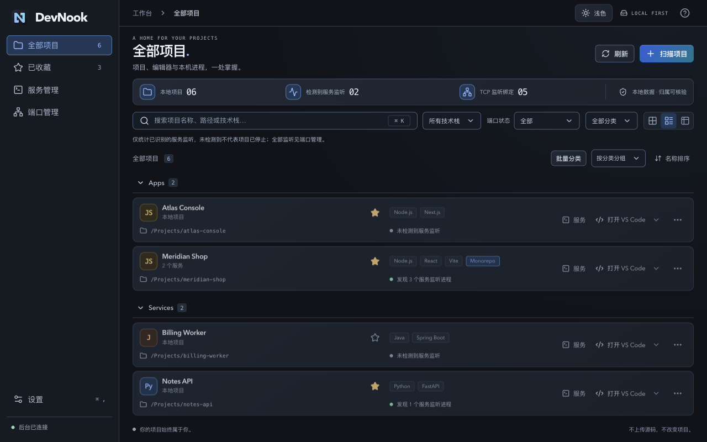
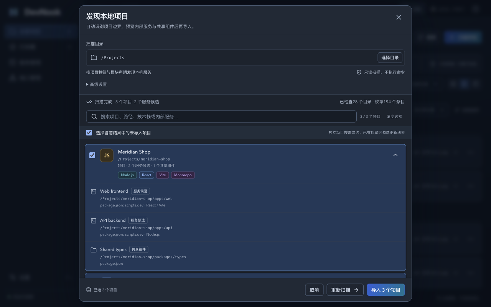
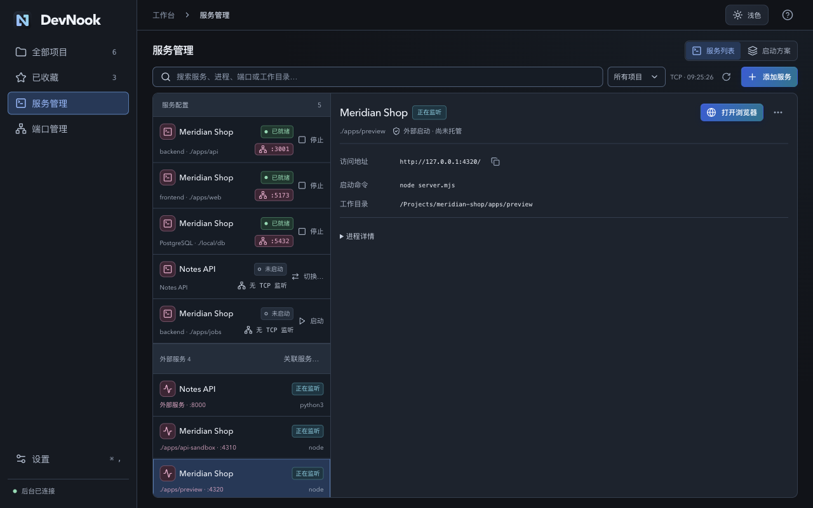
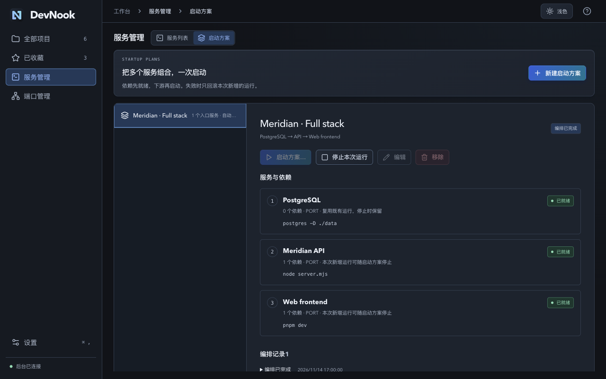

<p align="center">
  
</p>

<h1 align="center">DevNook</h1>

<p align="center">macOS 上的本地项目与开发服务管理器。</p>

<p align="center">
  <strong>简体中文</strong> · <a href="README.en.md">English</a>
</p>

<p align="center">
  <a href="https://acorn2.github.io/devnook/">官网</a> ·
  <a href="#核心功能">能做什么</a> ·
  <a href="#快速开始">快速开始</a> ·
  <a href="#cli-与-ai-助手">CLI / MCP</a> ·
  <a href="#文档">文档</a> ·
  <a href="LICENSE">MIT License</a>
</p>

**找项目、开服务、查端口。** DevNook 把磁盘上的代码工程、常用编辑器、启动配置和运行状态放进一个桌面工作台。你可以导入已有项目，确认启动前后端服务，集中查看日志，或从占用端口找到对应进程和目录。

[下载 macOS 安装包](https://github.com/Acorn2/devnook/releases/download/v0.1.0/DevNook_0.1.0_aarch64.dmg) · [v0.1.0 发布说明与校验文件](https://github.com/Acorn2/devnook/releases/tag/v0.1.0) · [从源码运行](#快速开始)

如果你同时维护几个本地工程，可以从这些任务开始：

| 你想做的事                   | 在 DevNook 中怎么做                                            |
| ---------------------------- | -------------------------------------------------------------- |
| 找回一个项目并继续开发       | 扫描导入后，用搜索、分类或收藏找到工程，再交给常用编辑器。     |
| 启动前端和 API，查看是否正常 | 保存启动配置，确认执行，在服务详情看就绪状态、实际端口与日志。 |
| 排查“端口已被占用”           | 打开端口管理，查看监听进程、命令、工作目录和项目归属。         |
| 按顺序准备一组服务           | 把已登记的服务组成启动方案，等待依赖就绪后再启动下游。         |



<p align="center"><sub>项目库。本文截图均为实际界面，使用演示项目与演示运行数据，不包含个人工程或进程信息。</sub></p>

## 核心功能

### 项目从目录导入，按习惯整理

选择代码目录，核对扫描候选、内部服务与共享组件，再勾选导入。同一仓库中的前后端可以保留在一个项目里，独立仓库也能单独选择。

- 按名称、路径、技术栈、分类与服务监听状态查找项目，支持收藏与批量分类。
- 紧凑列表、卡片和表格随时切换，分类分组可折叠，展示偏好在本机记住。
- 用已安装的 VS Code、Cursor、JetBrains 等编辑器 / IDE 打开工程；可设置全局或项目默认应用，也可打开 Finder / Terminal。
- 移除项目档案不会删除源码。扫描、导入和保存配置都不会运行项目命令。

<details>
<summary>查看导入前的候选预览</summary>



预览项目边界与组件后再导入。非标准目录可选择具体路径或启用深度补扫。

</details>

### 启动命令保存下来，运行与日志放在一起

进入项目的服务页，核对从工程清单识别出的启动建议，或填写自己的启动命令。保存配置后确认执行，下次开发时复用这份配置。

- 启动、停止、重启已登记的服务；启动前检查端口冲突与依赖状态。
- 同时查看运行状态和实际监听端口，从可用监听地址打开本地页面。
- 按运行记录查看 stdout / stderr，搜索日志关键字；历史运行与配置分别保留。
- 关闭应用窗口后，本机后台继续维护已经启动的服务与日志。



由终端或 IDE 启动的服务会独立标为外部。你可以核验身份后正常停止，或先保存独立配置，再单独确认切换为 DevNook 托管；旧环境、历史日志与 IDE 调试会话不会迁移。

### 从端口定位进程与项目

在端口管理中搜索端口、PID、命令或路径，查看进程命令、可执行文件、工作目录、启动时间与项目归属。项目、地址族、运行时和启动来源等筛选可以组合使用。


TCP IPv4 / IPv6 与多地址会合并展示，托管服务和外部监听保持区分。**未检测到监听不代表项目已停止。** 未知身份或无法核验归属的进程保持只读，外部停止需要核验并输入 PID 确认。

### 多个服务，按依赖顺序准备

在“服务管理 → 启动方案”中组合已登记的服务，入口可以来自不同项目。依赖会自动展开，等待上游就绪后再启动下游，例如数据库 → API → 前端。



启动前可预览完整计划。原本已运行的服务会被复用；失败、取消或停止方案时，只处理本次创建的实例，保留原有运行和后来手动重启的实例。保存方案只保存配置，不会自动执行。

### 终端、AI 助手与展示偏好

CLI 与可选的 MCP 接入共用桌面的本机后台、项目库、服务配置与运行记录。可在终端查询，或让编程助手读取状态和日志；MCP 默认只读，服务控制另需范围授权与对应确认。接入方式见下方 [CLI 与 AI 助手](#cli-与-ai-助手)。

桌面支持**浅色 / 暗色**和**简体中文 / English**。首次启动按系统首选语言选择：中文使用中文，其余语言使用英文；在“设置 → 界面语言”中可随时切换并记住手动选择。日常桌面使用无需配置 MCP。

<details>
<summary>项目识别范围与扫描限制</summary>

支持 JavaScript / TypeScript、Java / Kotlin、Python、Rust、Go、.NET、PHP、Ruby、Dart / Flutter、Swift / Xcode、C / C++ 的工程清单与组件线索。服务发现聚焦后端、Web 和本机开发服务器；明确的纯移动、桌面 GUI 和游戏客户端不会单独列为新候选。

默认扫描依据工程特征与模块声明发现项目。非标准目录可选择具体路径或启用深度补扫；静态识别无法解析的动态配置与自定义启动入口需要手动补充。详细范围见[扫描设计与类型覆盖](docs/scanner-features-plan.md)和[服务与客户端扫描边界](docs/service-eligibility-plan.md)。

</details>

## 快速开始

直接使用可从 [GitHub Releases](https://github.com/Acorn2/devnook/releases/latest) 下载 Apple Silicon DMG，打开后将 DevNook 拖入 Applications。当前安装包采用 ad-hoc 签名，尚未完成 Developer ID 签名或 Apple 公证；首次打开可能被 macOS 阻止，来源与校验说明见 [v0.1.0 发布说明](docs/releases/v0.1.0.md)。

以下步骤用于从源码运行，目标平台为 **macOS 12+**。开发与原生验收以 Apple Silicon 为主，Intel 和 macOS 12 真机尚需补充验证；Windows / Linux 暂不支持完整的本机进程与应用管理能力。

### 1. 准备开发环境

| 依赖                     | 要求                               |
| ------------------------ | ---------------------------------- |
| macOS                    | 12 或更高版本                      |
| Xcode Command Line Tools | 提供 macOS SDK 与本机构建工具      |
| Node.js                  | 20.19+（20.x）或 22.12+            |
| pnpm                     | 10，具体版本由 `package.json` 固定 |
| Rust                     | stable 工具链，包含 Cargo          |

### 2. 从源码运行

```sh
git clone https://github.com/Acorn2/devnook.git
cd devnook
pnpm install --frozen-lockfile
pnpm tauri dev
```

`pnpm tauri dev` 会同时启动前端与原生桌面应用。单独运行 `pnpm dev` 仅用于浏览器界面预览，无法扫描本机项目、管理服务或读取系统进程。

### 3. 导入第一个项目

1. 点击“扫描项目”，选择存放工程的目录。
2. 审阅候选项目，勾选需要的条目并导入。
3. 用默认编辑器打开项目，或进入项目的服务页面。
4. 核对启动建议；无法识别时填写启动命令，确认配置后再启动。
5. 在服务详情查看日志与实际监听端口，需要排查占用时进入“端口管理”。

扫描、导入和保存配置都不会执行项目命令。完整操作说明见[使用指南](docs/USAGE.md)。

## CLI 与 AI 助手

### CLI

CLI 与桌面共享本机后台、配置和运行记录，适合终端查询与脚本集成。

```sh
pnpm build:cli
./target/debug/devnook --help
./target/debug/devnook project list
./target/debug/devnook service list
./target/debug/devnook ports
./target/debug/devnook workspace list
```

CLI 还提供服务日志、启停、重启和启动方案管理，支持全局 `--json` 输出。会改变运行状态的操作遵循预览和确认流程；具体命令见 [CLI 使用说明](docs/PHASE-3.md#cli)。

### MCP（可选）

通过 stdio MCP，AI 编程助手可以查询项目、服务、端口和日志。桌面中的入口位于“设置 → 高级选项 → AI 助手接入”。

将下面的可执行文件路径替换为本机 CLI 的绝对路径，并按所用 MCP 客户端的配置格式填写：

```json
{
  "mcpServers": {
    "devnook": {
      "command": "/absolute/path/to/devnook",
      "args": ["mcp", "serve"]
    }
  }
}
```

默认接入只提供查询。服务控制需要额外创建范围授权，并遵循对应的确认流程；MCP 不开放任意 Shell、服务配置写入、外部进程终止或强制停止。配置与权限说明见 [MCP 接入指南](docs/PHASE-3.md#mcp-接入)。

## 数据与进程控制

- **扫描只读。** 不执行项目脚本、不安装项目依赖、不读取 `.env`，也不跟随符号链接；导入前先预览候选。
- **数据留在本机。** SQLite 保存项目与普通配置；敏感环境变量存入 macOS Keychain，数据库仅保存引用。运行日志按已登记的敏感值脱敏并限量保存。
- **执行需要确认。** 保存配置不会启动命令。启动与重启使用绑定配置版本的短期确认；端口冲突会阻止启动。
- **外部进程保持独立。** 关联项目不代表接管进程。停止外部服务需要核验身份并输入 PID 确认，仅发送 SIGTERM；强制停止仅用于另行确认的托管实例。
- **关闭窗口后继续运行。** 独立 Core 与 runner 维持已启动的服务和日志；DevNook 不安装 LaunchAgent。后台在没有活动服务且客户端闲置后可退出。

默认数据目录为 `~/Library/Application Support/com.devnook.desktop/`。端口状态来自实际 TCP 快照，“未检测到监听”不代表项目已停止，读取失败会显示状态不可用。本机 IPC 以当前 macOS 用户为信任边界，不提供多用户隔离或远程管理。更多说明见[使用指南](docs/USAGE.md#数据与边界)。

## 开发与验证

```sh
pnpm check
pnpm format:check
pnpm test:ui
pnpm build
pnpm check:rust
pnpm test
```

完整 Rust 集成测试还需要 **Python 3 和 JDK**，并使用隔离数据目录与测试进程。仓库包含 macOS GitHub Actions 工作流，覆盖类型、格式、界面数据测试、Rust 测试、CLI 与原生桌面构建。

<details>
<summary>构建 Release DMG（Apple Silicon）</summary>

```sh
pnpm tauri build --no-bundle
APPLE_SIGNING_IDENTITY=- CI=true pnpm tauri bundle --bundles app,dmg
node scripts/record-release.mjs
```

应用输出至 `target/release/bundle/macos/DevNook.app`，DMG 与校验和位于 `target/release/bundle/dmg/`。Release profile 已启用链接优化与符号裁剪；上述命令使用本机 ad-hoc 签名，不代表已完成 Developer ID 签名或 Apple 公证。完整验证与分发步骤见 [Release 说明](docs/RELEASING.md)。

</details>

<details>
<summary>构建本地 Debug 应用</summary>

```sh
pnpm tauri build --debug --bundles app
codesign --force --deep --sign - target/debug/bundle/macos/DevNook.app
codesign --verify --strict --deep target/debug/bundle/macos/DevNook.app
```

输出位于 `target/debug/bundle/macos/DevNook.app`。这里使用本机 ad-hoc 签名，用于开发验证；它不等同于 Developer ID 签名或 Apple 公证。Debug 包体积也不代表最终 Release 安装包体积。

</details>

### 代码结构

```text
apps/
  desktop/
    src/              React + TypeScript 界面
    src-tauri/        Tauri 原生适配层
  cli/                CLI 与 stdio MCP
crates/
  devnook-core/       扫描、存储、进程、服务与依赖编排
site/                 中英文静态官网
scripts/              本机构建、官网生成与检查
docs/                 使用说明、设计与开发记录
```

技术栈为 **Tauri 2、React 19、TypeScript、Rust 和 SQLite**。业务逻辑集中在 Core，桌面与 CLI 负责展示和调用；架构细节见 [ARCHITECTURE.md](ARCHITECTURE.md)。

## 文档

官网可通过 `pnpm site:build` 构建、`pnpm site:check` 检查，并以 `pnpm site:preview` 在本机预览；部署流程见 [GitHub Pages](docs/GITHUB-PAGES.md)。

| 文档                                                                      | 内容                                           |
| ------------------------------------------------------------------------- | ---------------------------------------------- |
| [使用指南](docs/USAGE.md)                                                 | 项目扫描、应用选择、服务操作、外观、语言与升级 |
| [服务托管](docs/PHASE-2.md)                                               | 生命周期、就绪检查、日志与进程身份             |
| [启动方案、CLI 与 MCP](docs/PHASE-3.md)                                   | 依赖编排、命令行、AI 接入与授权                |
| [扫描设计](docs/scanner-features-plan.md)                                 | 工程清单、模块声明与扫描限制                   |
| [服务识别边界](docs/service-eligibility-plan.md)                          | 服务、开发服务器与客户端的区分                 |
| [架构](ARCHITECTURE.md) · [技术栈](TECH-STACK.md) · [界面设计](DESIGN.md) | 工程结构与设计约定                             |
| [开发记录](docs/DEVELOPMENT-PLAN.md)                                      | 已实现功能、实际验证和已知限制                 |

## 参与贡献

欢迎提交可复现的 Bug、项目识别样例、翻译修正和功能建议。

- **报告问题：** 提供 macOS 版本、芯片架构、DevNook 版本、复现步骤和预期行为；日志与截图请先移除敏感信息。
- **改进识别规则：** 提供最小工程清单、目录结构及预期结果；不要附带真实密钥、`.env` 或私有源码。
- **提交代码：** 围绕单个问题修改，补充相关验证；新增行为先通过 [Issue](https://github.com/Acorn2/devnook/issues) 讨论，并同步维护中英文 README。

进程控制与扫描规则是项目的重要边界。请保留只读扫描、显式执行确认、进程身份核验和隔离测试，不以自动强杀或放宽权限替代问题修复。

## 许可证与致谢

DevNook 采用 [MIT License](LICENSE)。第三方依赖保留各自许可证，详见 [THIRD_PARTY_NOTICES.md](THIRD_PARTY_NOTICES.md)。

项目在产品研究中参考了 CodeDeck、Runbox 和 localhost，研究记录与复用边界见[参考研究](docs/REFERENCE-RESEARCH.md)。当前实现未引入这些项目的源码或视觉资产。
